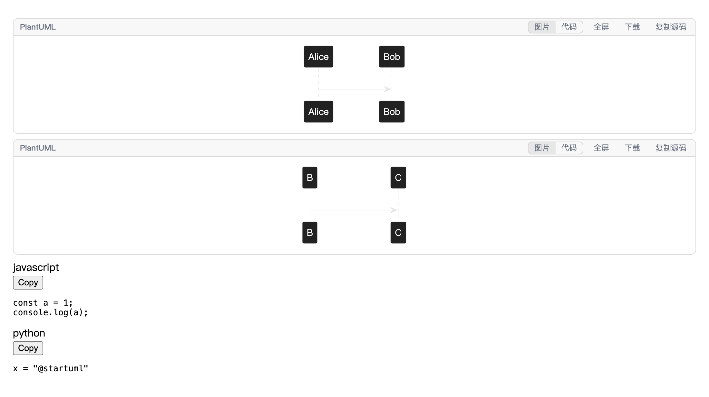

# dsh-plantuml

在 DSH 对话里把 ` ```plantuml ` 代码块渲染成图表，支持图片/源码切换、全屏缩放和
SVG/PNG 下载。渲染完全在浏览器内完成：没有 Java、没有 PlantUML 服务端、不发任何
网络请求。



## 功能

- 识别 `plantuml`、`puml`、`uml`、`iuml`、`pu`、`wsd` 六种围栏，也能识别没有语言标记但含成对
  `@start…` / `@end…` 的代码块。
- 每个图表自带 **图片 / 代码** 切换，源码可一键复制。
- **全屏查看器**：点图表或「全屏」进入，支持放大/缩小、适应窗口、1:1、拖拽平移、
  ctrl/⌘ + 滚轮缩放，快捷键 `+` `-` `0` `f` `Esc`。
- **导出** SVG（矢量）或 PNG（位图），导出的图片自带背景色，换主题也不会看不清。
- 跟随明暗主题重绘。
- 对话正文、工具结果以及所有由 app 渲染的 Markdown 区域都生效。

## 安装

本仓库是标准 DSH bundle（`package.json` 内含 `dsh.bundle.patch`）。

### 插件页安装（推荐）

**设置 → 插件 → 添加插件**，填包规格：

```
github:DeeliN221/dsh-plantuml
```

管理器会安装依赖并登记 bundle，之后在插件列表启用 **PlantUML 图表**。

### 命令行

```bash
dsh plugin add github:DeeliN221/dsh-plantuml
```

`dsh plugin add` 只加依赖，不会登记 bundle。还需要把 `"dsh-plantuml"` 加入
profile `package.json` 的 `dsh.profile.bundles`，执行
`dsh plugin --profile <name> install`，然后重启 DSH 进程。只刷新页面不够：
Node 侧要注册 `/dsh-plantuml/core.js` 路由和带指纹的引擎资源。

### npm

暂未发布到 npm，当前公开渠道是上面的 GitHub 规格；发布后可直接：

```bash
dsh plugin add dsh-plantuml
```

## 结构

| 路径 | 内容 |
| --- | --- |
| `lib/index.js` | Node 侧：把 `vendor/` 里的引擎资源和 `core.js` 挂到 `/dsh-plantuml` 前缀路由，提供清单发现、指纹不可变缓存、压缩与 Range 支持。 |
| `lib/client.js` | 浏览器侧：在 DOM 层接管 `.md-code-block`，按需加载共享 core 与指纹引擎；围栏发现、沙箱、主题/语言和查看器留在这一侧。 |
| `vendor/` | 官方 TeaVM 版 PlantUML 引擎与标准库（未改动）。 |
| `locale/` | 插件列表里的中文/英文标题与简介。 |
| `icon.svg` | 插件列表图标。 |
| `cordis.patch.yml` | bundle 挂载声明。 |
| `scripts/verify-assets.mjs` | 仅使用 Node 标准库的资源路由验收脚本（`npm run verify`）。 |

## 缓存与传输

- **发现清单（`/dsh-plantuml/engine.json`）**：返回当前插件 `version`、`hash`（`vendor/` 全部文件内容的 SHA-256 前 16 位十六进制指纹）、不可变引擎 URL `/dsh-plantuml/<hash>/plantuml.js` 与标准库前缀 `/dsh-plantuml/<hash>/stdlib/`。当前响应体为 **150 字节**（< 1 KB），携带 `Cache-Control: no-cache` 与强 `ETag`，`If-None-Match` 命中返回 `304`。
- **版本化不可变资源（`/dsh-plantuml/<hash>/*`）**：携带 `Cache-Control: public, max-age=31536000, immutable`。客户端首次加载并缓存后，刷新页面仅对 `engine.json` 发一次条件验证请求（命中 `304` 无 body），引擎与已缓存的 `stdlib/` 直接命中浏览器本地缓存，不再请求或重传大文件；插件升级后 `engine.json` 返回新指纹 URL，自动切换到新资源。
- **兼容旧路径**：`/dsh-plantuml/plantuml.js` 与 `/dsh-plantuml/stdlib/*` 仍保留可用，响应携带 `Cache-Control: no-cache` 与强 `ETag`，避免旧页面缓存 404。
- **传输压缩**：按请求头 `Accept-Encoding` 协商 `br`（Brotli quality 6）或 `gzip`（level 9），返回 `Content-Encoding`、`Vary: Accept-Encoding` 与区分编码的强 `ETag`（例如 `` `"<digest>-br"` ``、`` `"<digest>-gzip"` ``），并在首次压缩后于内存缓存压缩结果。针对 `vendor/plantuml.js`（原始 **4,013,244 字节**）实测：
  - `gzip`：**1,106,930 字节**（约原始大小的 27.58%）
  - `br`：**999,823 字节**（约原始大小的 24.91%）
- **条件请求与 Range**：支持 `If-None-Match`（返回 `304`）、`HEAD`（返回完整响应头无 body）以及单段字节 `Range`（返回 `206` + `Content-Range`，越界返回 `416`）。**限制**：当请求携带 `Range` 头时禁用传输压缩，直接按未压缩原始字节切片返回 `206`/`416`，不支持同时返回 `Content-Encoding` 与 `Range`。

## 上游与许可

本仓库派生自 [dlutcat/dsh-plantuml](https://github.com/dlutcat/dsh-plantuml)（MIT），
改动仅限打包方式与外观：`dsh.bundle.patch`、`icon.svg`、`locale/`、
`manifestVersion` 与文档。引擎代码来自官方
[plantuml/plantuml-for-github](https://github.com/plantuml/plantuml-for-github)，
版权归 PlantUML 项目（Arnaud Roques），许可见 [NOTICE.md](NOTICE.md)。
